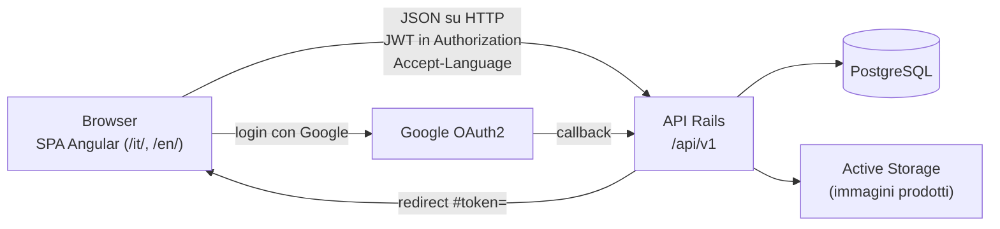
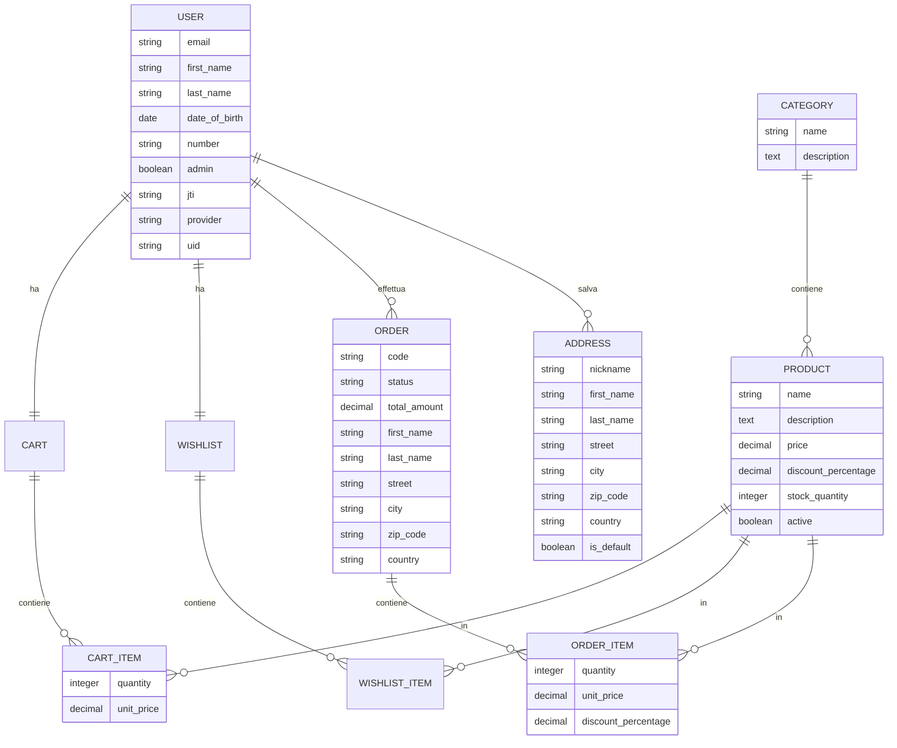
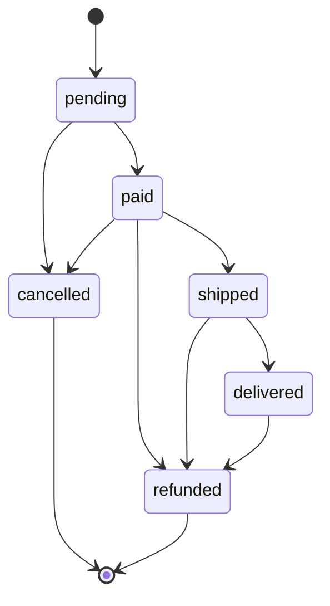

# SW Store — architettura

Ultimo aggiornamento: 2026-10-15.

## Panoramica



- **Due applicazioni separate** che comunicano solo tramite l'API JSON: `backend/` (Rails 8.1, modalità API) e `frontend/` (Angular 21). Il contratto è `backend/API.md`, unica fonte di verità sugli endpoint.
- **Autenticazione stateless** con JWT (devise-jwt, revoca con strategia JTI): il backend non usa sessioni né cookie, e CORS ammette solo l'origine della SPA (`FRONTEND_URL`).
- **Il backend è la fonte di verità** per prezzi, sconti, disponibilità, carrello e ordini. Il frontend non ricalcola nulla: mostra i valori ricevuti.
- **i18n su entrambi i lati.** La SPA è compilata una volta per lingua (`/it/`, `/en/`) e invia la propria lingua nell'header `Accept-Language`, con cui il backend localizza i messaggi.

Le due sezioni seguenti descrivono in dettaglio ciascuna parte. In fondo ci sono il deploy e la CI.


## Backend

API JSON in Ruby on Rails 8.1 (modalità API, `config.api_only = true`) su PostgreSQL. Tutti gli endpoint sono sotto `/api/v1`. Il contratto completo è in `backend/API.md`.

### 1. Modelli del dominio



| Modello | Relazioni | Validazioni e regole principali |
| ------- | --------- | ------------------------------- |
| **User** (Devise) | `has_one :cart`, `has_one :wishlist`, `has_many :orders`, `has_many :addresses` | Email obbligatoria, unica e in formato valido; password di 6–128 caratteri; se indicata, la data di nascita deve essere di un maggiorenne. Carrello e wishlist creati alla registrazione. `admin` non è modificabile via API. |
| **Category** | `has_many :products` (`restrict_with_error`) | Nome obbligatorio e unico. Una categoria con prodotti non si elimina (409). |
| **Product** | `belongs_to :category`; `has_many :cart_items`, `:wishlist_items` (eliminati col prodotto); `has_many :order_items` (`restrict_with_error`); immagine con Active Storage (`has_one_attached :image`, variante `thumb` 100×100) | Nome obbligatorio; descrizione di almeno 10 caratteri; prezzo ≥ 0; sconto 0–100 (opzionale); stock ≥ 0; `active` booleano (default true, NOT NULL). Immagine JPEG/PNG/WebP ≤ 5 MB, tipo verificato dai magic bytes. Un prodotto già ordinato non si elimina: si disattiva. |
| **Cart** | `belongs_to :user` (unico per utente); `has_many :cart_items` | Calcola `items_count` e `total_amount`. `add_product` somma la quantità se il prodotto è già presente. |
| **CartItem** | `belongs_to :cart`, `belongs_to :product` | Quantità intera > 0; `unit_price` ≥ 0; un prodotto per carrello (validazione + indice unico); prodotto attivo; quantità ≤ stock. I prezzi esposti seguono prezzo e sconto **attuali** del prodotto. |
| **Order** | `belongs_to :user`; `has_many :order_items` | Dati cliente e spedizione obbligatori, totale ≥ 0, stato da enum validato. Codice `ORD-AAAA-NNNNN` progressivo per anno. Transizioni di stato controllate; i dati di spedizione si modificano solo finché l'ordine è `pending`/`paid`. |
| **OrderItem** | `belongs_to :order`, `belongs_to :product` | Quantità intera > 0; `unit_price` ≥ 0. `unit_price` è il prezzo **pagato**, già scontato, fissato al checkout. |
| **Wishlist / WishlistItem** | Wishlist: `belongs_to :user`, `has_many :wishlist_items`; WishlistItem: `belongs_to :wishlist`, `belongs_to :product` | Un prodotto non può essere aggiunto due volte (controllo nel controller). "Sposta nel carrello" applica le regole di disponibilità del carrello. |
| **Address** | `belongs_to :user` | Nome, cognome, via, città, CAP, paese obbligatori; `nickname` obbligatorio e unico per utente. |

### 2. Autenticazione

- **Credenziali (Devise + devise-jwt).**
  - `POST /auth/login` restituisce il JWT nell'header `Authorization: Bearer <token>`; il token dura 1 giorno.
  - Il frontend lo invia a ogni richiesta protetta.
  - Revoca con strategia **JTI**: il token contiene il `jti` dell'utente, e il logout (`POST` o `DELETE /auth/logout`) lo rigenera, invalidando tutti i token emessi per quell'utente.
  - `GET /auth/me` restituisce l'utente corrente.
  - Il 401 di Devise (credenziali errate) passa da `CustomFailureApp`, che risponde nel formato standard degli errori.
- **Google OAuth2 (OmniAuth).**
  1. Il frontend invia un form `POST /auth/google_oauth2`, che reindirizza a Google.
  2. Google richiama la callback, gestita dal backend.
  3. Il backend associa l'account: prima cerca un utente già collegato (provider + uid), poi un utente registrato con la **stessa email verificata** da Google, che viene collegato; altrimenti crea un nuovo utente.
  4. Emette un JWT equivalente a quello del login e reindirizza a `FRONTEND_URL/oauth/callback#token=<jwt>`. Il token sta nel **fragment**, quindi non finisce nei log dei server né nel Referer. Gli errori vanno in query (`/login?error=oauth_failed`).
- **Rischio residuo accettato:** la request phase non verifica un token CSRF (`request_validation_phase = nil`). È basso perché la callback è protetta dal parametro `state` di OAuth2, e un CSRF sull'avvio può solo far partire il login della vittima sul suo stesso account: non esiste il collegamento di un account Google a un utente già autenticato.

### 3. Flusso login → carrello → checkout → ordine (lato server)

1. **Login:** `POST /auth/login` (o Google) → JWT.
2. **Carrello** (solo utente autenticato):
   - `GET /cart`: righe con prezzo scontato, totale di riga e totale del carrello.
   - `POST /cart/items { product_id, quantity }`: somma la quantità se il prodotto è già presente.
   - `PATCH /cart/items/:id` imposta la quantità; `DELETE /cart/items/:id` rimuove la riga. `:id` è l'id del CartItem, cercato solo nel carrello dell'utente (altrimenti 404).
   - Aggiunta e modifica rifiutano con 422 i prodotti inattivi e le quantità oltre lo stock.
3. **Checkout:** `POST /orders { order: dati cliente e spedizione }` esegue `Order.create_from_cart` in **un'unica transazione**:
   - blocca i prodotti del carrello con `SELECT … FOR UPDATE`, in ordine di id per evitare deadlock tra checkout concorrenti;
   - ri-valida ogni riga sotto lock (prodotto attivo, stock sufficiente): se qualcosa non va, rollback e 422 con un messaggio per prodotto;
   - crea l'ordine con un OrderItem per riga, fissando prezzo scontato e sconto del momento; il totale è la somma delle righe;
   - decrementa lo stock e svuota il carrello.

   Qualsiasi errore annulla tutto (carrello e stock restano invariati). Carrello vuoto o dati mancanti → 422.
4. **Ordini:** `GET /orders` (filtro `status`, anche multiplo) e `GET /orders/:id`, limitati agli ordini dell'utente (un ordine altrui dà 404). `DELETE /orders/:id` annulla l'ordine.

**Stati dell'ordine e transizioni consentite** (validate dal modello; una transizione non consentita dà 422):



- L'**annullamento** (`cancelled`, solo da `pending` o `paid`) **ripristina lo stock** con un `UPDATE` atomico (`update_counters`) nella stessa transazione. `Order#cancel` prende un lock sulla riga dell'ordine, così due annullamenti concorrenti non ripristinano lo stock due volte.
- Il **rimborso** (`refunded`) non ripristina lo stock: la merce resa non è necessariamente rivendibile.

### 4. Scelte trasversali

- **Formato delle risposte** (concern `ApiResponses`):
  - successo: `{ success: true, message, data, meta }`;
  - errore: `{ success: false, message, errors: [...] }`, con `errors` sempre non vuoto.
- **Gestione degli errori** centralizzata in `Api::V1::BaseController` (`rescue_from`):

| Status | Caso |
| ------ | ---- |
| 400 | JSON malformato, oggetto radice mancante, parametro non valido (data, `order_by`, `status`, soglia della dashboard) |
| 401 | Token assente, non valido, scaduto o revocato; credenziali errate |
| 403 | Utente non admin su `/admin/*`; admin che tenta di eliminare sé stesso |
| 404 | Risorsa inesistente o non appartenente all'utente (ordini, righe del carrello, indirizzi); prodotto inattivo nel catalogo pubblico |
| 409 | Eliminazione di record ancora referenziati (prodotto ordinato, categoria con prodotti), violazioni di unicità concorrenti |
| 422 | Validazione fallita (dati del form, disponibilità, transizioni di stato, immagine) |
| 500 | Errore imprevisto: risposta nel formato standard senza dettagli tecnici, stack trace nel log |

- **i18n:**
  - la lingua (`it` di default, `en`) si ricava dall'header `Accept-Language` (`RequestLocale`);
  - è applicata attorno a `process_action`, quindi vale anche per le risposte dei `rescue_from`, e in `CustomFailureApp` per il 401 di Devise;
  - messaggi API ed errori dei modelli sono in `config/locales/{it,en}.yml`.
- **Autorizzazione** (concern `Authorization`):
  - gerarchia di controller `BaseController` (pubblico) → `AuthenticatedController` (`authenticated_access_only`) → `AdminController` (`admin_access_only`);
  - le risorse dell'utente sono sempre cercate a partire da `current_user` (es. `current_user.orders.find`).
- **Paginazione:** Pagy con `page` e `limit` (default 10, max 30); i metadati sono in `meta`. `GET /categories?all=true` restituisce tutto senza paginazione.
- **Ordinamento:** il concern `Sortable` accetta per `order_by` solo le colonne indicate da ogni endpoint (whitelist) e per `order_direction` solo `asc`/`desc`. Altri valori danno 400; non si interpola mai SQL.
- **Ricerca:** `q` con `ILIKE` sul nome, con i caratteri jolly `%` e `_` neutralizzati.
- **Seed:** `db/seeds.rb` è idempotente e non distruttivo (`find_or_create_by!`, nessun update o delete). Crea 4 categorie, 12 prodotti attivi con immagine e gli utenti demo (admin, cliente, utenti E2E).
- **Configurazione:** in produzione tutto arriva da variabili d'ambiente (`DB_*`, `RAILS_MASTER_KEY`, `FRONTEND_URL`, `BACKEND_URL`); i segreti sono nelle credentials cifrate.
- **Qualità:** test Minitest (modelli, request, seed); RuboCop, Brakeman e bundler-audit in CI.

### 5. Funzionalità avanzate (parte backend)

- **Area admin** (`/api/v1/admin/*`, ruolo `admin` verificato lato server):
  - **CRUD prodotti:** include i prodotti inattivi, con ricerca, filtro per categoria e ordinamento. L'immagine si carica in `multipart/form-data` nello stesso `POST`/`PUT`, con validazione di tipo e dimensione; c'è anche la rimozione dell'immagine. L'eliminazione è bloccata (409) se il prodotto è in ordini.
  - **CRUD categorie:** con `products_count`; l'eliminazione è bloccata (409) se la categoria contiene prodotti.
  - **Gestione utenti:** lista con ricerca e ordinamento, modifica, eliminazione (non di sé stessi).
  - **Gestione ordini:** filtri per testo, stato (anche multiplo), intervallo di date e di importo; cambio di stato secondo le transizioni consentite; annullamento con ripristino dello stock.
  - **Dashboard** (`GET /admin/dashboard`): ordini per stato, fatturato (esclusi annullati e rimborsati), conteggi di prodotti e utenti, prodotti con stock basso, ultimi ordini.
- **Internazionalizzazione:** tutte le risposte dell'API (messaggi di successo, errori, validazioni dei modelli, errori di Devise) sono disponibili in italiano e inglese, in base ad `Accept-Language`.


## Frontend

SPA Angular 21 con componenti standalone, template inline, `inject()` e signal. Interfaccia con Angular Material e TailwindCSS. Tutte le chiamate vanno all'API Rails (`/api/v1`) secondo il contratto `backend/API.md`.

### 1. Struttura

```
src/app/
  core/
    http/          un API service per risorsa (products, cart, orders, wishlist, auth, admin/*)
                   + interceptor, gestione errori (api-error.ts), URL dell'API (api-config.ts)
    services/      stato dell'app e logica: ProductsService, CartService, OrdersService,
                   AuthService, WishlistsService, servizi admin
    models/        interfacce delle risorse e normalize.ts (conversione delle risposte)
    guards/        loggedInGuard, notLoggedInGuard, adminGuard
    i18n/          lingue supportate, calcolo dell'URL dell'altra lingua, testi del paginatore
    state/         AuthStore: sessione (utente + JWT), unico dato salvato in localStorage
    validators/    validator dei form (es. conferma password)
  components/      componenti riutilizzabili (card prodotto, selettore quantità, form prodotto, dialog...)
  pages/           una cartella per pagina; pages/admin/ per l'area amministrativa
  layout/          header (azioni utente, badge, selettore lingua), layout admin
```

Separazione delle responsabilità:

- **API service** (`core/http`): solo HTTP, nessuno stato. Costruiscono payload e query string del contratto e normalizzano le risposte: il backend serializza i decimali come stringhe (`"89.91"`), che `normalize.ts` converte in numeri una volta sola, così il resto dell'app usa i tipi dei modelli.
- **Service di stato** (`core/services`): tengono lo stato in signal privati (`#cart`, `#orders`...) ed espongono signal in sola lettura e `computed`. I componenti leggono i signal e chiamano metodi, senza conoscere l'HTTP.
- **Componenti e pagine**: presentazione e form (Reactive Forms). Tutte le rotte sono caricate in lazy loading (`loadComponent`).

### 2. Gestione dello stato

- **Il backend è la fonte di verità.** Carrello, wishlist e ordini vengono letti dall'API; a ogni risposta lo stato viene sostituito con quello restituito dal server (es. `data: Cart`). Prezzi, totali e regole di disponibilità sono calcolati solo dal backend: il frontend mostra `total_price`, `total_amount`, `items_count` così come arrivano.
- **Unica parte ottimistica: la quantità di una riga del carrello.** Viene mostrata subito al click; il PATCH parte dopo 400 ms dall'ultimo click, separatamente per ogni riga (`groupBy` + `debounceTime` + `switchMap`, così conta solo l'ultima quantità). In caso di errore la riga torna alla quantità confermata dal server. Finché ci sono modifiche non confermate il checkout è disabilitato.
- **localStorage solo per la sessione** (`AuthStore`: utente e JWT), così il login sopravvive al reload. All'avvio (`provideAppInitializer` → `AuthService.restoreSession()`), se c'è una sessione, carrello e wishlist vengono riletti dal backend: il carrello sopravvive al reload perché è sul server, non perché è salvato nel browser.
- Le chiamate HTTP non sono mai dentro `signal.update()`: gli aggiornamenti dello stato avvengono nei callback delle risposte.

### 3. Flusso login → carrello → checkout → ordine

1. **Login** (`LoginPage`, `AuthService.signIn`): `POST /auth/login`; il JWT arriva nell'header `Authorization` e viene salvato in `AuthStore`. Poi `startSession()` carica carrello e wishlist. In alternativa il login con Google: form `POST /auth/google_oauth2`, ritorno su `/oauth/callback#token=<jwt>`; `AuthCallback` legge il token dal fragment, lo toglie subito dalla barra degli indirizzi (`Location.replaceState`) e verifica l'utente con `GET /auth/me`.
2. **Richieste autenticate**: catena di interceptor funzionali registrata in `app.config.ts`:
   - `loadingInterceptor`: indicatore di caricamento globale;
   - `errorInterceptor`: gestione centralizzata degli errori (sezione 4);
   - `apiInterceptor`: antepone l'URL dell'API (`API_URL`, da `environment.ts`);
   - `apiHeadersInterceptor`: aggiunge `Authorization: Bearer <jwt>` solo se c'è un token e `Accept-Language` (`it`/`en`) secondo la lingua dell'interfaccia, così i messaggi del backend arrivano nella lingua giusta.
3. **Rotte riservate**: `loggedInGuard` su carrello, wishlist, checkout, conferma, "I miei ordini" e dettaglio ordine (verifica la sessione con `GET /auth/me`); `adminGuard` sull'area admin (ospite → `/login`, utente non admin → `/forbidden`); `notLoggedInGuard` su login e registrazione.
4. **Carrello** (`CartService`): `POST /cart/items`, `PATCH`/`DELETE /cart/items/:id` (id della riga). Gli errori 422 (prodotto non attivo, stock insufficiente) mostrano il messaggio del backend.
5. **Checkout** (`CheckoutPage`, Reactive Form con validazioni): `OrdersService.checkout` invia `POST /orders` con i dati di spedizione e un token di pagamento dimostrativo (`stripe_payment_token`, obbligatorio per il backend). Lo stato del checkout è un signal (`idle` / `submitting` / `error` / `success`): durante l'invio il bottone è disabilitato con spinner; in caso di errore un pannello mostra il messaggio del backend e un pulsante **Riprova** rimanda la stessa richiesta senza perdere i dati del form; l'errore si azzera a ogni ingresso nella pagina. Con il carrello vuoto la pagina lo dice invece di mostrare il form.
6. **Conferma**: in caso di successo si va su `/checkout/confirmation/:orderId` (codice, totale, link al dettaglio e agli ordini) e il carrello viene riletto dal server, che lo ha svuotato.
7. **I miei ordini**: lista paginata (`page`, `limit`) con filtro per stato (anche multiplo), dettaglio con prodotti, prezzi pagati, spedizione e avanzamento dello stato.

### 4. Gestione degli errori

- L'`errorInterceptor` trasforma ogni `HttpErrorResponse` in un oggetto uniforme `ApiError { status, message, errors }`, accettando sia il formato standard del backend (`{ success, message, errors }`) sia quello dei 401/403 e di Devise (`{ error, message }`).
- Gestione globale: 0 (server non raggiungibile) e 5xx → toast; 401 → sessione chiusa e redirect al login; 403 → `/forbidden`. Il 404 e i 422 sono lasciati alle pagine e ai service, che sanno come mostrarli (pagina "non trovato" per un prodotto o un ordine inesistente, errori nei form, messaggi di stock).
- I service estraggono i messaggi con gli helper di `api-error.ts` (con un testo di fallback tradotto) e li espongono in signal di errore separati per contesto (lista, dettaglio, checkout, form).
- Alcune richieste saltano la gestione globale con il token `BYPASS_GLOBAL_ERROR_HANDLING` (login con credenziali errate, logout con token già revocato).

### 5. Internazionalizzazione

- `@angular/localize`, a build time: testi marcati con `i18n="@@id"` nei template e `$localize` nel codice; traduzioni in `src/locale/messages.xlf` (italiano, sorgente) e `messages.en.xlf`.
- `ng build` produce una build per lingua, servite in `/it/` e `/en/` (base href dedicato, attributo `lang` della pagina impostato dalla build).
- **Selettore di lingua** nell'header: porta alla stessa pagina nella build dell'altra lingua, mantenendo percorso e query string (`/it/products?q=x` → `/en/products?q=x`).
- La lingua dell'interfaccia (`LOCALE_ID`) determina anche `Accept-Language` verso il backend, la formattazione di date e valute, i tempi relativi e i testi del paginatore Material (`LocalizedPaginatorIntl`).
- Scelta: niente librerie di traduzione a runtime. Il cambio di lingua ricarica la pagina, in cambio di nessun costo a runtime e del supporto nativo di Angular.

### 6. Accessibilità

- Tutti gli elementi interattivi sono raggiungibili da tastiera (`button` e `a` veri: voci di categoria, card prodotto e ordine, menu admin), con un indicatore di focus visibile.
- Etichette: `mat-label` sui campi, `aria-label` sui pulsanti con sola icona, testi alternativi significativi o vuoti per le immagini decorative, `role="alert"` sui messaggi di errore, `role="status"`/`aria-live` su caricamenti e quantità, `aria-current` su categoria e lingua attive, tabelle con intestazioni `scope`.
- Contrasto dei colori corretto secondo WCAG AA (verificato con axe).
- Test E2E automatici: navigazione del catalogo solo da tastiera e analisi axe (WCAG 2 A/AA, zero violazioni) su catalogo, login, registrazione, dettaglio prodotto, dashboard e categorie admin.

### 7. Test

- **Unit (Vitest)**: 112 test in 24 file, eseguiti con `npx ng test --watch=false`.
  - service con `HttpTestingController` e l'interceptor reale: `CartService` (inizializzazione, aggiunta, quantità con debounce, rollback su 422, rimozione), `OrdersService` (checkout, errore, retry, lista con filtri e paginazione), `WishlistsService`, `AuthService`, `AuthApiService`, admin prodotti e categorie;
  - interceptor e gestione errori, guard admin, validator delle password, pipe, calcolo dell'URL della lingua;
  - componenti: checkout (caricamento, errore, Riprova), catalogo (ricerca e reset pagina), registrazione, login, callback OAuth, form prodotto (immagine), selettore lingua.
- **E2E (Playwright)**: 27 test sul server di sviluppo (`npx playwright test`) più 3 sulla build localizzata (`npm run e2e:i18n`). Coprono il flusso della demo (login → carrello → checkout → conferma → I miei ordini → dettaglio), errore al checkout con Riprova, carrello persistente dopo il reload, login con Google simulato, logout con revoca del token, catalogo e ricerca, area admin (CRUD di categoria e prodotto con immagine), cambio lingua e accessibilità. I test usano utenti dedicati e non lasciano dati: svuotano i carrelli, annullano gli ordini creati (ripristinando lo stock) ed eliminano categorie e prodotti creati.

### 8. Funzionalità avanzate lato frontend

- **Area admin** (`/admin`, `adminGuard`):
  - dashboard con contatori, fatturato, ordini per stato, prodotti con stock basso e ultimi ordini;
  - prodotti: lista con ricerca, filtri e ordinamento; creazione e modifica con upload, sostituzione e rimozione dell'immagine (anteprima, controllo di tipo e dimensione); eliminazione con conferma (409 se il prodotto è già stato ordinato);
  - categorie: CRUD, con eliminazione impedita se contengono prodotti;
  - ordini: lista con filtri e dettaglio; il cambio di stato propone solo le transizioni ammesse;
  - utenti: lista con ricerca.
- **Internazionalizzazione** italiano/inglese con selettore (sezione 5).
- Inoltre: wishlist persistente sul backend, storico ordini con filtro per stato e dettaglio completo.

### 9. Dimensione del bundle

Il bundle iniziale è di circa 730 kB (circa 180 kB trasferiti con gzip). Tutte le rotte sono già in lazy loading: nel bundle iniziale restano Angular (circa 318 kB), i componenti Material dell'header (menu, toolbar, badge, barra di caricamento) e il sistema di toast usato dalla gestione degli errori. Scendere sotto il budget predefinito di 500 kB avrebbe richiesto di togliere Material dall'header: si è scelto invece di portare il budget a 800 kB (warning) / 1 MB (errore).

## Deploy e integrazione continua

- **Docker** (opzionale):
  - `backend/Dockerfile`: immagine di produzione di Rails con Thruster sulla porta 80; all'avvio esegue `db:prepare` (crea i database, applica lo schema e carica il seed).
  - `frontend/Dockerfile`: build multi-stage (`ng build` con Node, poi nginx). nginx serve `/it/` e `/en/` con il fallback SPA; `/` porta a `/it/`.
  - `docker-compose.yml` nella root: servizi `db` (PostgreSQL 17), `api` (porta 3000) e `frontend` (porta 4200).
  - Limite: l'URL dell'API del frontend è fissato al momento della build (`API_URL`) ed è quello usato dal browser.
  - Le immagini Docker non sono state provate nell'ambiente di sviluppo, dove Docker non era disponibile.
- **CI** (`.github/workflows/ci.yml`), su push verso `main`/`development` e sulle pull request:
  - job `backend`: PostgreSQL di servizio, `bin/rails test`, RuboCop, Brakeman, bundler-audit;
  - job `frontend`: `npm ci`, test unitari Vitest, build di produzione.
  - Gli E2E Playwright restano locali: richiedono entrambi i server e i dati di seed (vedi `frontend/README.md`).
  - Il job backend richiede il secret `RAILS_MASTER_KEY` nel repository GitHub.
